## Two target tools

{width=40%} &nbsp;&nbsp; {width=40%}

    * https://cran.r-project.org/package=peppwR
    * https://cran.r-project.org/package=pepdiff

::: {.notes}
The main question we'll ask is whether an experiment can actually see what you'd like it to see. In science we have habits of experimental design, standards like 3 replicates and a p-value of 0.05. We'll see why they are actually usually useless numbers to use and should be abandoned. In looking for proper solutions to this Im going to show you the R packages my group have created — `peppwR` and `pepdiff` — that help you design large scale proteomics experiments but can be used for any typical experiment in the MPMI field.
:::

## Roadmap

::: {.r-stack}
**Power analysis** &nbsp; · &nbsp; **peppwR** &nbsp; · &nbsp; **pepdiff**
:::

<br>

- the classical recipe and where it runs out
- power analysis for high-throughput, skewed, missing data
- the analysis end of the same workflow

::: {.notes}
We'll pass through these three connected topics. First,  we'll look at what power in an experiment is and how analysis helps and why standard methods break on most data types. We'll look at some simple things that improve the power of any experiment — in general, not specific to phosphoproteomics. Then we'll look at applying a power analysis in an 'omics scale experiment  using the `peppwr` package. Our example will be phosphoproteomics but it'll be generally applicable information.  And then we'll look at `pepdiff`, the analysis-stage companion.
:::

## Power analysis {.section-divider}

<br>

*The chance our experiment can finding something given that it is there.*

::: {.notes}
There are many ways to think about what the power of an experiment is, but today we're going to mean it in the most important,
basic sense. The sense of discovery. And that gives us this definition. The power is the chance that our experiment will find the difference we're
looking for, in the known event that it is definitely there.

Ideally we'd want the chance to be 100%, but in reality, as we'll see, the power of our experiments is vastly below this.

And that's a problem for a lot of experiments, if not all.
:::

## What "power" actually means
<br>
In a test of $H_0$ vs $H_1$, power is the probability of correctly rejecting $H_0$ when $H_1$ is true.

$$
\begin{aligned}
\text{Power} &= \Pr(\,\text{reject } H_0 \mid H_1\,) \\
             &= 1 - \beta
\end{aligned}
$$
<br>

- $\alpha$ — false-positive rate (we *choose* this; conventionally $0.05$)
- $\beta$ — false-negative rate (we do *not* choose this directly)

::: {.notes}
The rest of our talk relies on some definitions.
Power is the chance of finding something given that it is there. The formal definition gives us a concrete version.  In a test of a null hypothesis against an alternative, like in every stats test we do. Power is the probability of correctly rejecting the null when the alternative true. Two distinct errors can happen in an experiment.
A test can call an effect that isn't there — a false positive, with rate alpha, which we conventionally fix at five percent. This is the p-value.
Or it can miss an effect that is there — a false negative, with rate beta. Alpha is something we choose. Beta is not, so that's what power analysis focusses on, estimating that beta.
:::

## Power contextualised

$$
\text{power} = 1 - \beta
$$

<br>
An experiment with power $0.3$ misses **70%** of real effects of the size it was designed to detect.

::: {.notes}
Power is one minus beta. So a test with power 0.3 misses seventy percent of real effects of the size it was designed to detect. So its our job to try and push that number down by designing around beta.
:::

---

## The four levers

::: {.columns}
::: {.column width="65%"}
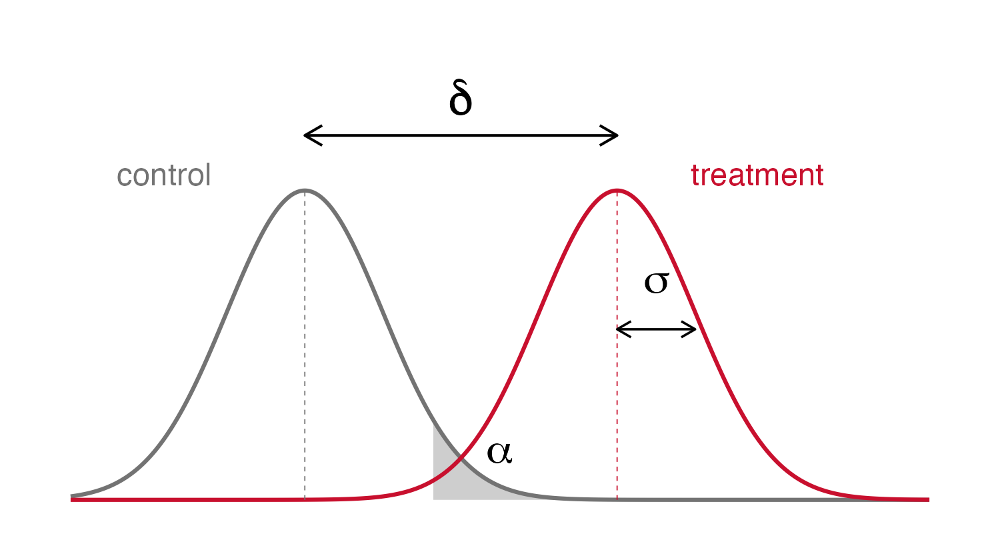{fig-align="center"}
:::
::: {.column width="35%"}
- $\delta$ — true difference in means
- $\sigma$ — within-group SD
- $n$ — sample size per group
- $\alpha$ — significance threshold
:::
:::


::: {.notes}
There are four parameters in a common experiment, we can see them as features of this picture. These two overlapping curves represent idealised measurements from control and treatment group in some imagined experiment.

The horizontal gap between the peaks is $\delta$, the true difference in means.

The half-width of either curve is $\sigma$, the usual within-group standard deviation.

The sample size $n$ which isn't shown does not change the curves themselves, but it narrows the sampling distribution of the mean — the curves would get thinner and SD would reduce as.   And $\alpha$ the level at which we accept a positive result lives in the tail of the control curve. That curve is our null model and is the slice of area we agree to call rare enough that we stop believing that the treatment values came from the same as the control values. These four levers are the things we can play with to increase our power.
:::

## Two curves, low power and high power

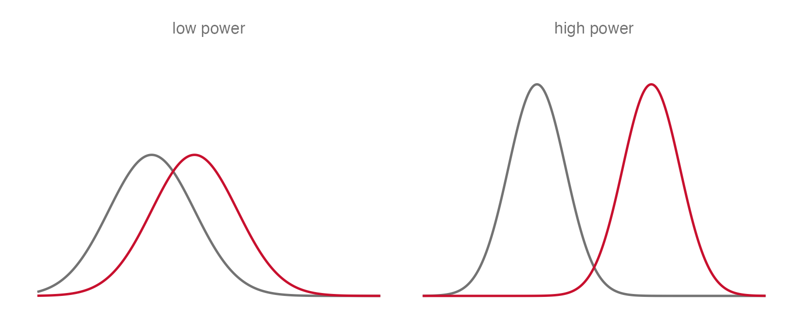{fig-align="center" width="85%"}

- Pull apart ($\delta$), narrow down ($\sigma$), or sample more ($n$) shrink the overlap, increase power.
- $\alpha$ changes false positive rate


::: {.notes}
To increase power we want to reduce the overlap, and we can do that by messing about with the levers. On the left, the curves sit close together and the shaded overlap is large — low power. On the right, the same two curves are pulled apart, the overlap is small, and a test is much more likely to tell them apart. If we increase $\delta$ and pull the curves apart, we get better power. If we narrow each curve with lower variability, causing smaller $\sigma$ we get more power. If we take more samples the larger $n$ narrows the sampling distribution of the mean we get more power.

Decreasing $\alpha$ And being stricter about what counts as a difference — actually moves us the other way, because it shrinks the rejection region we want. But this is important since lower $\alpha$ trades power for false-positive control.
:::

## $p$ is not power

> $p$ is not power, and a small $p$ does not measure how real an effect is.

<br>

::: {.notes}
$\alpha$ is the level at which we accept the p-value as being significant. Usually we blindly set this to 0.05, but thats a convention not a mathematical rule. And its worth finding out that $p$, whatever it is, does not equate to power, so alpha isn't a good lever for power.

A small $p$ is not a measurement of how big or how reliable an effect is. Lets have a look at that.
:::

## What $p$ actually is

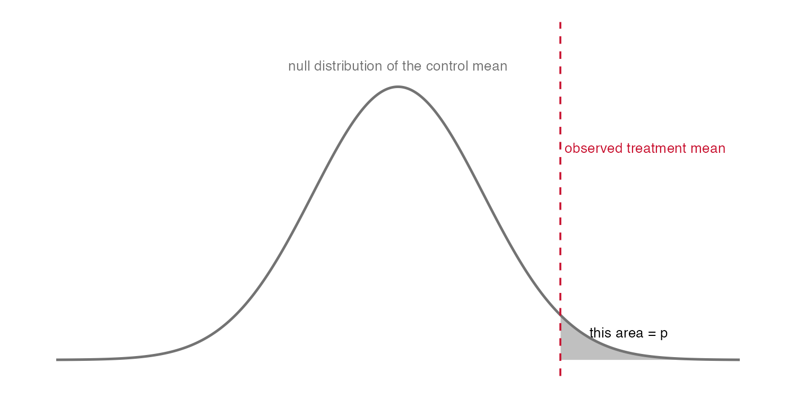{fig-align="center" width="80%"}

*How often would the control alone produce a mean this extreme?*

::: {.notes}
p is just the answer to the question, how often would the control data produce this result.
To estimate this we fit a normal distribution to the control values. We then imagine drawing $n$ values at random from a population that looks like the control. P is how often would the draw end up as extreme as the treatment mean we actually observed? That long-run frequency is what the $p$-value approximates. It is a statement about how surprising the data would be under an assumed null — its not the probability that the alternative is true, and not a measurement of whether the experiment was sensitive enough to find what it was looking for. Its just a statement about unlikeliness. Power asks the inverse question: given the alternative is true, how often do we catch it. Power is a property of an experimental design, then.  Not of the readout of p.
:::

<!--
## Power is a property of a design

*Post-hoc power on the observed effect adds no new information.*

Hoenig & Heisey (2001).

::: {.notes}
Power is a property of an experimental design, then.  Not of the readout of p.
Computing power after the fact, on the observed effect size, and using it to argue that a result is somehow more or less believable is a well-documented mistake — observed power is essentially a deterministic transform of the $p$-value and adds nothing new. Hoenig and Heisey is the standard reference. Prose lines 81–83.
:::
-->

## Standardising size of differences for comparison

Cohen's $D = \delta / \sigma$

| $D$ |       |
|---|-------|
| 0.2 | small |
| 0.5 | medium |
| 0.8 | large |

- Mean difference, in units of SD.
- Guiding numbers, not hard rules.

::: {.notes}
One difficulty is that our experiments are always in different units, so comparing the size of the effect, the difference in means from the control and treatment group, we have these standardised forms of them, called effect sizes, the most common is Cohen;s $D$ — which is just the mean difference expressed in units of the standard deviation. The conventional scale of this is that   $0.2$ indicates a small effect , $0.5$ medium, $0.8$ large. $D$ puts curves from different experiments on a single scale and we can use it to see how large and small effect sizes affect power.
:::

## The classical power curve

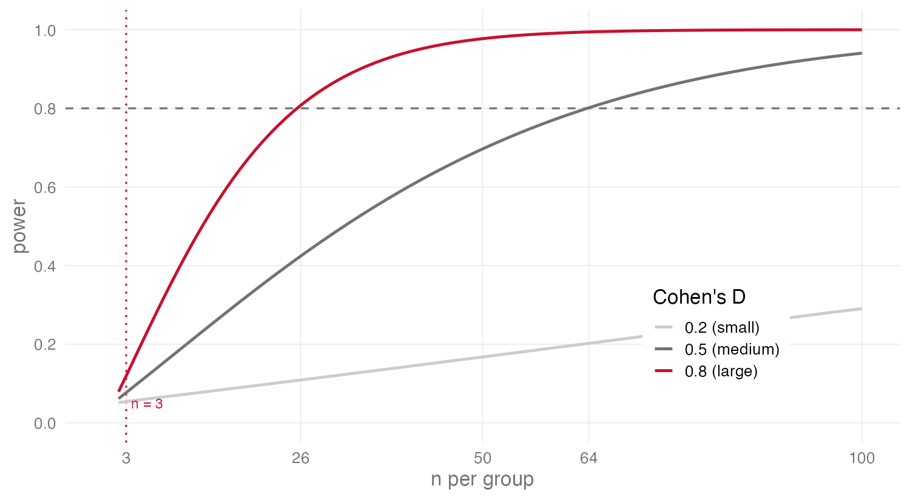{fig-align="center" width="80%"}

::: {.notes}
With those we are able to plot curves like these, which shows the power in a standard t test on appropriate data with different effect sizes and sample size.  The dashed line is an $80\%$ power target, which is about where we'd want it to be. Notice where each curve crosses it. For a *large* effect, $D = 0.8$, we need about twenty-six biological replicates per group.  The bench norm of $n = 3$ per group sits far to the left of the rising part of every one of these curves, so its very likely that three reps is not giving you the best chance to find your difference at all.
:::

## Is my old experiment worthless?

**Almost certainly not.**

- A small-$n$ comparison that returned a clear effect is still the data it always was.
- High-throughput experiments quietly omit large fractions of true biology when underpowered.

::: {.notes}
That makes us wonder whether any earlier experiments were any use. For a single small-$n$ comparison that returned a clear effect, the answer is no — that result is still the data it always was, and a power calculation does not reach back through time and undo it. But it does mean you are likely to have concluded no where there was an effect at various times. This is a false negative and has led you down the wrong track. In particular this hurts  in high-throughput experiments, which are really many tests in parallel, false negatives compound across the peptidome or the transcriptome and  underpowered high-throughput experiments quietly omit large fractions of true biology, and there is no way to improve that without planning the experiment better.
:::

<!--
## Trick one: merge technical replicates honestly

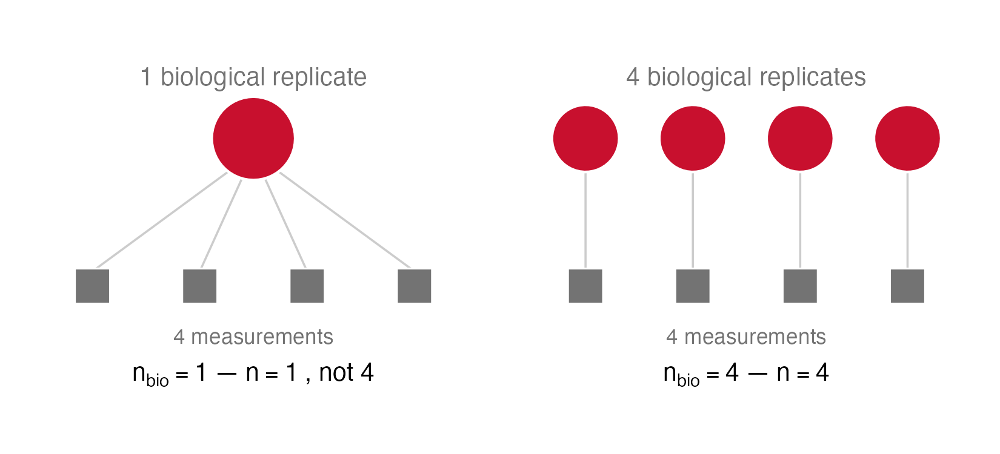{fig-align="center" width="85%"}

**Counting tech reps as biological is $n$-hacking, which is $p$-hacking.**

::: {.notes}
Two cartoons, side by side. On the left, one mouse, four tubes — four measurements of the same biological material. That is $n_{\text{bio}} = 1$, not $n = 4$. On the right, four mice, one tube each — four independent draws from the population the experiment claims to be about. That is the $n$ that carries statistical leverage. Extra rows from the same animal shrink the sample standard deviation artificially, which shrinks the standard error, which shrinks $p$. Counting non-independent measurements as independent is $p$-hacking via the denominator. The fix is procedural. Prose lines 115–119.
:::

## Ordinal scores need a different merge

*For ordinal scores, rank first — then average.*

| raw score | rank | bio rep | mean rank |
|:---:|:---:|:---:|:---:|
| 0 | 1   | A | **3.17** |
| 2 | 3.5 | A |  |
| 3 | 5   | A |  |
| 1 | 2   | B | **3.83** |
| 4 | 6   | B |  |
| 2 | 3.5 | B |  |

::: {.notes}
For ordinal scores — disease ratings, severity classes — the arithmetic mean of the raw score is not really meaningful, because the gaps between categories are not numerically equal. The right move is to rank the technical replicates first and then average the ranks within each biological replicate. That respects the ordinal scale and still gives one number per independent unit, which is what the test needs. Prose lines 122–123.
:::

-->

## Decide $n$ before the experiment


1. Choose target — power (e.g. $0.8$) and $\alpha$ (e.g. $0.05$)
2. Estimates of $\delta$ and $\sigma$ needed - use pilot data or literature
3. Solve for $n$  (e.g using `pwr.t.test()` )
4. Run the experiment with that biological $n$ as planned


*Run a power calculation before you waste time and money.*

::: {.notes}
So we do a power analysis to work out what we need, to reach the power we expect. We pick a target power — eighty percent is conventional — and a significance threshold. If we're looking for $n$ we need to plug in $\delta$ and $\sigma$ which we usually have a fair idea of from pilot data or sensible literature numbers. Next we use the R function `pwr.t.test` or similar which returns the per-group $n$ we need. We can then plan the experiment to that biological $n$ and be much more certain about our experiment behaving as we expect.
:::

<!--
## A real anonymous example

*HR scoring, ordinal 0–6, multiple genotype pairs.*

- Tech reps pooled into per-group $n$
- Ordinal scores plotted as violins
- Pairwise $t$-tests across many comparisons

::: {.notes}
A real case from a paper I'll keep anonymous. The readout was an ordinal hypersensitive-response score on a 0–6 scale. There were multiple technical replicates per biological replicate, several biological replicates per genotype pair, and many genotype pairs compared in a single figure. In the published version, the technical replicates had been pooled into a per-group $n$, the ordinal scores were plotted on a violin plot as if they were continuous, and pairwise $t$-tests ran across all the comparisons. Prose lines 129–131.
:::

## What the re-analysis showed

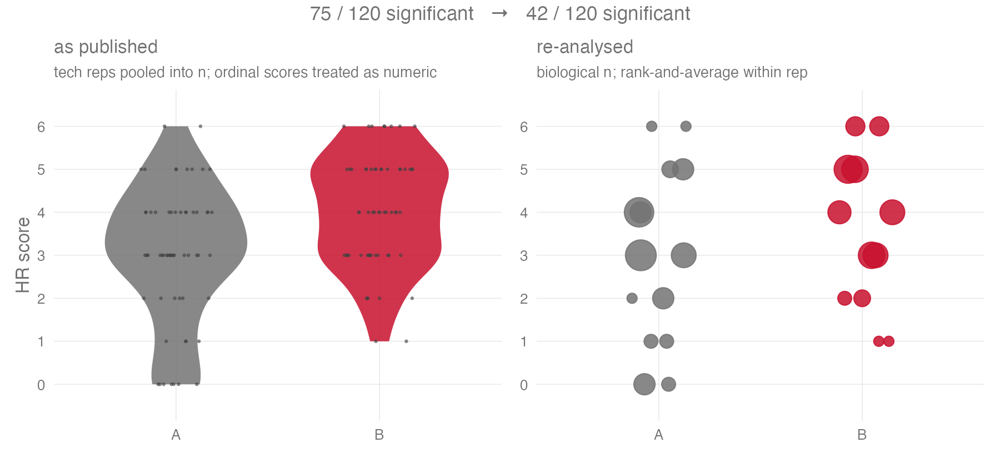{fig-align="center" width="85%"}

**$75 / 120$ significant $\rightarrow$ $42 / 120$ significant.**

*Rank-and-average within biological replicate, then use biological $n$ only.*

::: {.notes}
The original analysis returned seventy-five significant calls out of a hundred and twenty. After re-analysis — averaging ranks within each biological replicate to respect the ordinal scale, and using only the true biological replicates for inference — the count fell to forty-two. The difference between those two numbers is the false-positive inflation produced by the two mistakes on the previous slide. Prose lines 132–146.
:::


-->

## Standard tests fail on many high-throughput data types

*Can't assume normally distributed, complete data.*

::: {layout-ncol=3}
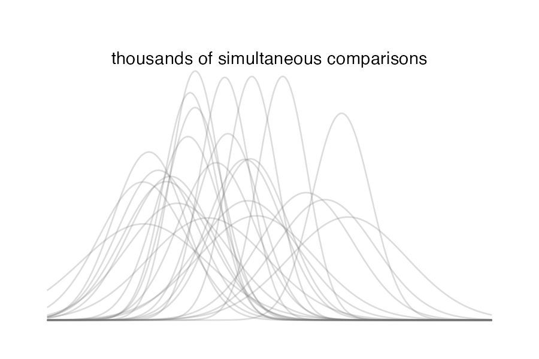

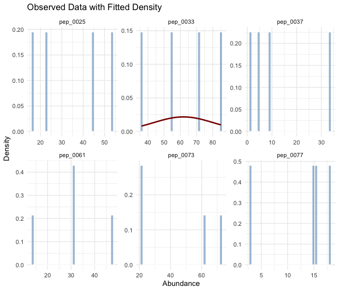

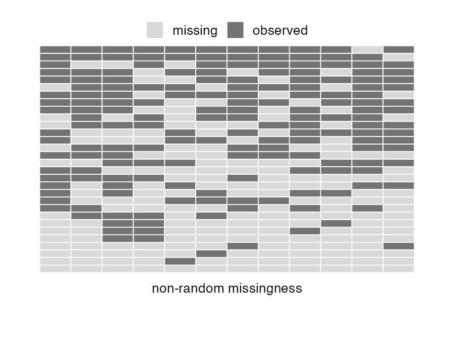
:::


::: {.notes}
So thats an idealised way to do it. And it holds pretty well for a lot of small scale experiments. The issue is everything so far assumed one $t$-test, on roughly normal data, with every observation present. A high throughput experiment e.g phosphoproteomics can break all three of those assumptions at once. We have thousands of simultaneous comparisons rather than one, values that are far from normal, span several orders of magnitude, and are heavily right-skewed rather than bell-shaped. And missingness that has patterns occurs. These break the t test method and we need a new recipe. We can instead use Simulation. Estimating power by regenerating the experiment many times under realistic assumptions and counting exceptions
:::

---

## peppwR {.section-divider}

{width=220 fig-align="center"}

*Power analysis for high-throughput, skewed, missing data.*

*Simulation in place of the closed form.*

::: {.notes}
And this is what peppwR is designed to implement. It does the same function, things like $\delta$, $\sigma$, $n$, $\alpha$ are all analysable Only the way the probability is computed changes, from a formula to Monte Carlo counting.
:::

## Start with the data not an assumption

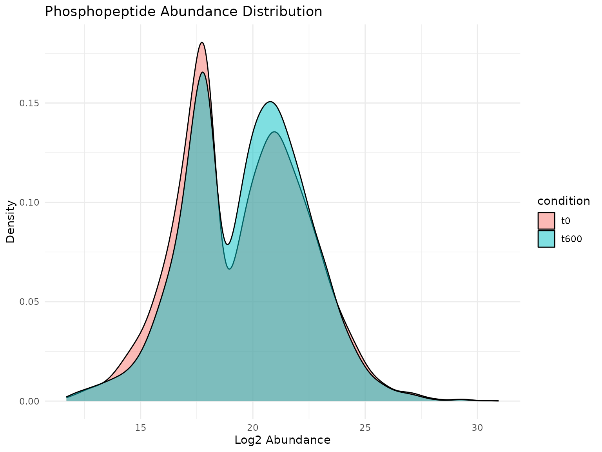{fig-align="center" width="75%"}


*Example peptide abundance from DDA experiment in Arabidopsis*

::: {.notes}
The way this works is we start with a histogram of real data rather than with an assumed probability distribution. This is the distribution of peptide intensities for one condition of a data-dependent acquisition phosphoproteomics dataset — DDA, the standard discovery-mode workflow in which the mass spectrometer picks precursors for fragmentation in real time. The dataset is *Arabidopsis thaliana*, and has captured two thousand two hundred and twenty-eight phosphopeptides, in up to but not always three biological replicates per timepoint.  The abundances are Several orders of magnitude wide on the $x$-axis. The data are right-skewed and there's a clear pile-up of mass near the detection limit. This isn't like the standard normal distribution
:::

<!--
## The four assumptions of the closed form

$$\pi(n, \delta, \sigma, \alpha)$$

- **Normality** — each group is normally distributed
- **Homogeneous variance** — both groups share a common $\sigma$
- **Complete data** — every observation is present
- **Single test** — one comparison, not many

::: {.notes}
The closed form bundles the same four symbols as before — $n$, $\delta$, $\sigma$, $\alpha$ — inside a single function $\pi$. To be allowed to use it, four things have to hold: each group is normally distributed, the two groups share a common standard deviation, every observation is present, and we are running one comparison. Prose lines 187–194.
:::

## All four assumptions fail at once

- **Normality** — marginal intensities are strongly right-skewed
- **Homogeneous variance** — variance scales with the mean
- **Complete data** — NA rates above 50% in discovery mode
- **Single test** — thousands of peptides tested simultaneously

::: {.notes}
Each one breaks for this kind of data. Normality fails because the marginal distribution of intensities is strongly right-skewed, as we just saw on the histogram. Homogeneous variance fails because in mass-spec data variance tends to scale with the mean, so peptides at very different abundance levels do not share a common $\sigma$. Complete data fails because discovery-mode runs routinely return NA rates above fifty percent. And single test fails because thousands of peptides are being tested simultaneously. .
:::
-->

## Candidate distribution families

- **Gamma** — continuous, positive, right-skewed; shape and rate
- **Lognormal** — variable whose logarithm is normal; multiplicative processes
- **Inverse Gaussian** — positive, right-skewed; intermediate tail behaviour

::: {.notes}
There are hree parametric distributions that capture the shape of that histogram reasonably well. Gamma — continuous, strictly positive, right-skewed, controlled by a shape and a rate parameter. Lognormal — the distribution of a variable whose logarithm is normally distributed, which is a natural model for multiplicative biological processes. And inverse Gaussian — also positive and right-skewed, with tail behaviour that sits between the other two. None of them is universally right for every peptide; each one captures the broad shape we just looked at, so they're good candidates for modelling peptide counts for simulation.
:::

## Picking between families: AIC

$$\text{AIC}_k = -2 \log L_k + 2 p_k$$

- $L_k$ is the maximised likelihood of model $k$
- $p_k$ its number of parameters
- Smallest AIC wins

::: {.notes}
When more than one of those families can give a plausible fit, we need a way to distinguish the best model. The conventional choice is the Akaike Information Criterion — a model-selection criterion that rewards goodness of fit through the likelihood term, and penalises model complexity through the parameter count. The smallest AIC wins. So we need to do that on each peptide in turn. Fit the real peptide data to the model and assess. That's what peppwR does, it fits each candidate family per peptide and selects on AIC.
:::

## Fitting per peptide: `fit_distributions()`

::: {.columns}
::: {.column width="42%"}
```r
fits <- fit_distributions(
  pilot_data,
  id    = "peptide",
  group = "condition",
  value = "abundance"
)

plot(fits)
```

*A `peppwr_fits` S3 object with `print`, `plot`, `summary` methods.*
:::
::: {.column width="58%"}
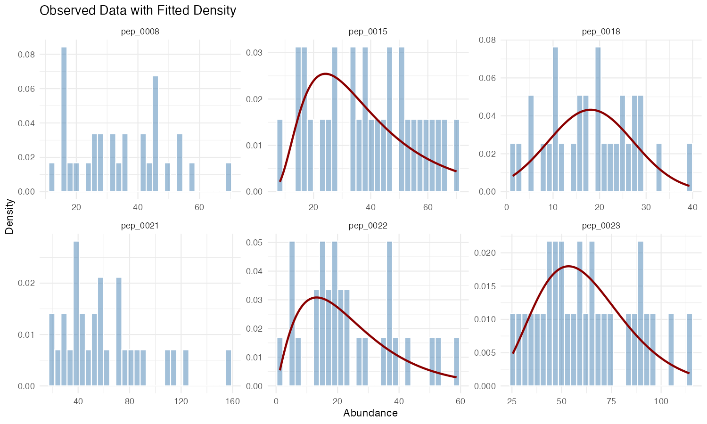{fig-align="center"}
:::
:::

::: {.notes}
Within the package `fit_distributions()` is the entry point for per-peptide work. If you have it, it takes the pilot data, from eg an excel file, the column naming the peptide, the column naming the experimental group, and the column carrying the abundance value. For each peptide it tries the candidate families, picks one by AIC, and records each peptide's missingness rate $r_i$ alongside its fit. The return value is a typed object — `peppwr_fits` — so the rest of the pipeline can dispatch on it. It provides print, plot and summary methods so you can assess the result. These results show a lot more measurments than the normal 3 to emphasise the fit. With just 3 you get a basic estimate.
:::

## Assessing whether missingness is random

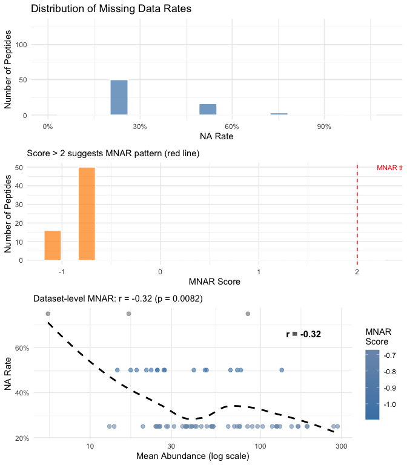{fig-align="center" width="65%"}

<!-- Source is a three-panel diagnostic; bottom panel (NA rate vs log mean abundance) is the one this slide talks to. Crop before final if needed. -->


::: {.notes}
`peppwR` will also help you work out whether there are patterns to the missing data in your sample. It creates a histogram of missing rates for peptides with missing data and finds patterns by correlating the mean peptide abundance with missing rate, The bottom panel here shows a negative trend when there is systematically missing data. Each dot is a peptide. On the $x$-axis, its mean log abundance; on the $y$-axis, the proportion of samples in which it was not detected.  Low-abundance peptides drop out more often than high-abundance ones. The cause for this is mechanical: the instrument has a detection limit, and peptides whose true abundance sits near that limit fail to be detected systematically. The missingness is structured by the abundance of the peptide.
:::

## MNAR vs MCAR

- **MNAR** — *Missing Not At Random.* Probability of missingness depends on the value itself.
- **MCAR** — *Missing Completely At Random.* Probability of missingness is independent of the value.

*Pretending MCAR overstates what the experiment can detect.*

::: {.notes}
In general then there are two ways a datapoint can be missing. MNAR — missing not at random — is what we have just seen, the missingness depends on the very value that is missing. MCAR — missing completely at random — is the usual assumption that whether a value is missing has nothing to do with how big it would have been. Power calculations and later tests that pretend MCAR systematically overstate what the experiment can detect.
:::

## peppwR detects MNAR at the dataset level

- Compute per-peptide mean abundance and per-peptide NA rate.
- Take the Spearman correlation between them.
- Significantly negative $\rightarrow$ flag dataset as MNAR.

::: {.notes}
And `peppwR` does this to identify whether MNAR might be present. For each peptide we have a mean abundance and an NA or missing rate. We take the Spearman correlation across peptides between those two quantities; a significantly negative correlation is the dataset-level signature of MNAR, and peppwR raises the flag. That flag drives the optional missingness-aware simulation path that we'll see next.
:::

## The simulation recipe, one peptide at a time

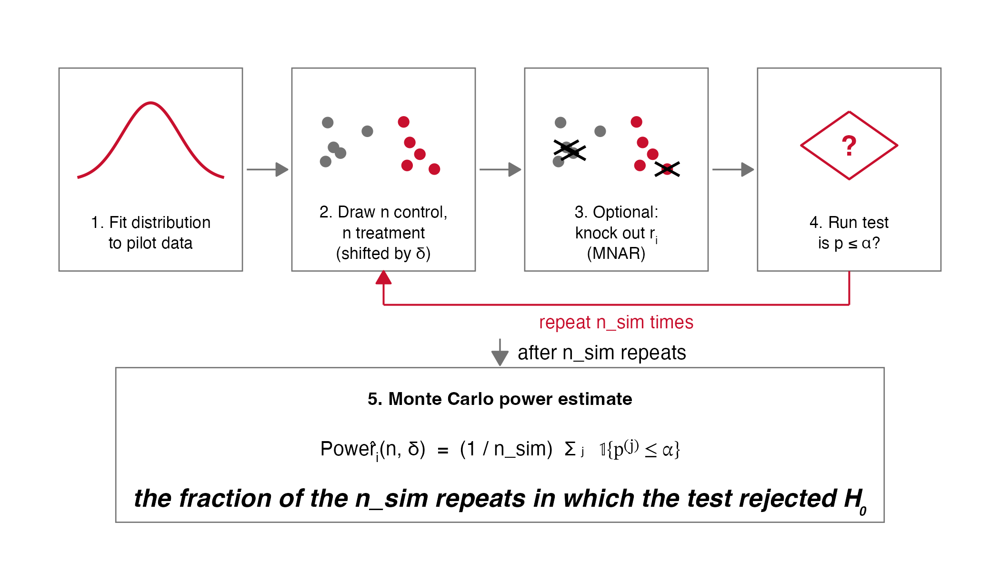{fig-align="center" width="95%"}

::: {.notes}

So with that information we can start to begin simulating abundances and testing how often we see a difference.
We do this procedure for each peptide. We fit a distribution to its pilot values, giving estimated parameters. We draw $n$ control values from that fitted distribution, and $n$ treatment values from the same distribution scaled by an effect size $\delta$. Optionally — when the MNAR flag is up — we knock out a fraction $r_i$ of those values to mimic the missingness pattern. We then run whichever statistical test we mean to use on the simulated samples and record whether the $p$-value came in below $\alpha$. And we repeat that whole thing many times. The fraction of repetitions in which we rejected the null is our Monte Carlo power estimate for that peptide.
:::

## Monte Carlo power
*powerful counting*

$$\hat\pi_i(n, \delta) \;=\; \frac{1}{n_\text{sim}} \sum_{j=1}^{n_\text{sim}} \mathbf{1}\!\left[p^{(j)} \leq \alpha\right]$$

- $\mathbf{1}[\cdot]$ is the indicator function.
- Same $n, \delta, \alpha$ as before ($\sigma$ enters implicitly through the fitted distribution)


::: {.notes}
I've mentioned this method Monte Carlo twice not, but Monte Carlo estimates are just a kind of powerful counting. The power is estimated as the average over simulations of an indicator function that returns one  when we reject the null hypothesis and zero otherwise. Overall the  The same four parameters are still in play — $\sigma$ enters implicitly through the fitted distribution rather than as its own argument — but the probability is now computed by counting rather than by calculus as its done in the t test example.
:::

## Three tests inside the engine

::: {.columns}
::: {.column width="38%"}
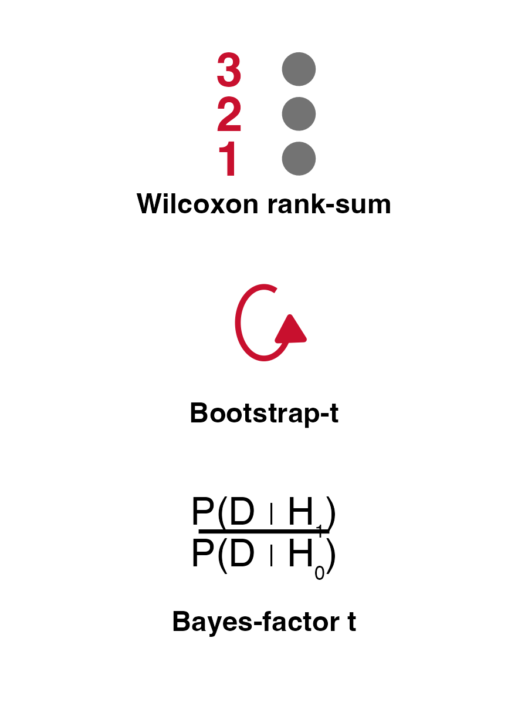{fig-align="center"}
:::
::: {.column width="62%"}
- **Wilcoxon rank-sum** — rank-based two-sample comparison (default)
- **Bootstrap-$t$** — resampling variant of the two-sample $t$-test
- **Bayes-factor $t$-test** — ratio of marginal likelihoods under $H_1$ and $H_0$
:::
:::

::: {.notes}
So Ive mentioned twice that we reject the null somehow but haven't said how we test. peppwR supports three different tests in its Monte Carlo simulations. The Wilcoxon rank-sum test is the default — rank-based, robust to non-normality, well-behaved at small $n$. The bootstrap-$t$ is a resampling variant of the two-sample $t$-test that pulls lots of samples over and over. And the Bayes-factor $t$-test returns the ratio of marginal likelihoods of the data under the alternative and the null, with a rejection threshold we can express in $\alpha$-equivalent terms. and as we'll see pepdiff exposes the same tests at the analysis stage.
:::

## What `peppwR` can tell you

::: {.columns}
::: {.column width="55%"}
- `find = "sample_size"`
  - given $\delta, \sigma, \pi_\text{target}$, find smallest $n$
- `find = "power"`
  - given $n, \delta, \sigma$, return $\hat\pi$
- `find = "effect_size"`
  - given $n, \sigma, \pi_\text{target}$, return smallest detectable $\delta$
:::
::: {.column width="45%"}
```r
result <- power_analysis(
  fits,
  effect_size = 2,
  n_per_group = 6,
  find        = "power",
  n_sim       = 500
)
```
:::
:::


::: {.notes}
After fitting distributions to each peptide, peppwR can help answer the three questions a researcher actually asks at the bench. What sample size do I need? What power will the experiment I'm planning have? And what is the smallest effect I can hope to detect with the sample size I can afford? Each of these is an optimisation over the same simulation engine. In peppwR they're exposed through the `find` argument of `power_analysis()` — `"sample_size"`, `"power"`, or `"effect_size"` — and the return value is a `peppwr_power` S3 object with print, plot, and summary methods.
:::


<!--
## Per-peptide mode: with pilot data

*One fit per peptide, one simulation per peptide.*

- Fit gamma / lognormal / normal / inverse Gaussian per peptide; AIC-select.
- Track each peptide's missingness rate $r_i$ alongside the fit.
- Run the Monte Carlo recipe independently per peptide.

::: {.notes}
With pilot data in hand, we can do better. Per-peptide mode fits a distribution for every peptide individually — gamma, lognormal, normal, inverse Gaussian, picked on AIC — and tracks each peptide's missingness rate along the way. The simulation engine then runs the recipe we just walked through independently for each one. The output is no longer a single power number; it is a power per peptide, which is the granularity at which a real phosphoproteomics experiment actually behaves. Prose lines 281–283.
:::
-->

## The peptidome power

$$P_\text{peptidome}(n, \delta, \pi_\text{target}) \;=\; \frac{1}{K}\sum_{i=1}^{K} \mathbf{1}\!\left[\hat\pi_i(n, \delta) \geq \pi_\text{target}\right]$$

- $K$ is the number of peptides
- "X% of peptides reach 80% power at $n = Y$"

::: {.notes}
With one power number per peptide, we need a way to summarise. The peptidome fraction is the proportion of peptides whose estimated power meets the target. It's just an aggregate: it tells us what share of the peptidome it is powered for. The headline format reads "X percent of peptides reach eighty percent power at $n = Y$". Prose lines 285–289.
:::

## When per-peptide fitting fails

::: {.columns}
::: {.column width="55%"}
- **`"exclude"`** (default) — drop the peptide, report the count.
- **`"empirical"`** — resample empirically from observed values.
- **`"lognormal"`** — substitute a moment-matched lognormal.

*Configured via `on_fit_failure`.*
:::
::: {.column width="45%"}
```r
fits <- fit_distributions(
  pilot_data,
  id    = "peptide",
  group = "condition",
  value = "abundance",
  on_fit_failure = "empirical"
)
```
:::
:::

::: {.notes}
Per-peptide fitting will fail for some peptides, those with small samples, extreme values or numerical trouble. peppwR exposes three fallback strategies through `on_fit_failure`. The default is to exclude the peptide and report how many were excluded. The empirical option resamples from the peptide's observed values rather than from a parametric family. The lognormal option substitutes a moment-matched lognormal — a robust last resort. The analyst gets to pick, rather than have peptides silently disappear. Prose line 291.
:::

## Aggregate mode: no pilot data

```r
result <- power_analysis(
  distribution = "gamma",
  params       = list(shape = 2, rate = 0.05),
  effect_size  = 2,
  target_power = 0.8,
  find         = "sample_size",
  n_sim        = 5000
)
```

*Returns $n^\ast = 25$ per group.*

::: {.notes}
You can also do the analysis if you have no pilot data to sample from. Aggregate mode does this. The analyst supplies a distribution family and parameters directly. For these gamma parameters, asking for $80\%$ power to detect a two-fold effect, the simulation returns twenty-five per group. That's likely to be accurate an order-of-magnitude answer, which is the right kind of answer for a grant-proposal conversation about how big the experiment needs to be.
:::

## Making power curves: aggregate-mode power curve

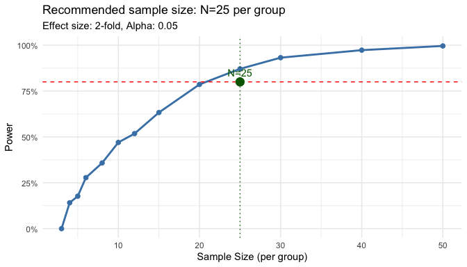{fig-align="center" width="70%"}

::: {.notes}
A power curve can be generated from that, we have $n$ per group on the $x$-axis, estimated power on the $y$. The curve rises with sample size, hits the eighty percent target, and the function reports the crossing $n$. This is the same rising-then-saturating shape we saw from earlier — only now produced by simulation.
:::

## Multiple testing

At $\alpha = 0.05$ across $5{,}000$ tests,

expected false positives under the null = $250$.

<br>

*Not a usable workflow*

::: {.notes}
The remaining assumption is that we use just single-test, that the chance of getting a false positive is 0.05. But once thousands of tests run in parallel, the false positive error rate compounds. Five thousand tests at $\alpha = 0.05$,  would be expected to throw two hundred and fifty false positives. That is not a usable number.
:::

## Benjamini–Hochberg

$$p_{(k^*)} \;\leq\; \frac{k^*\, \alpha}{m}$$

- Ordered $p$-values $p_{(1)} \leq \cdots \leq p_{(m)}$.
- Find the largest rank $k^*$ satisfying the inequality
- Reject every hypothesis with $p \leq p_{(k^*)}$.

::: {.notes}
The standard fix in genomics and proteomics is the Benjamini–Hochberg procedure. Order the $p$-values from smallest to largest and compare them against a steadily rising cutoff line which gets less strict. Instead of judging each result alone, the threshold forces the data points to compete against each other to determine which discoveries are truly significant. This controls the false discovery rate — the expected proportion of false positives among the calls declared significant.
:::

## FDR-aware power: `apply_fdr = TRUE`

*Power under BH*

1. Simulate a full peptidome (true positives + nulls).
2. Apply BH.
3. Count true positives among the discoveries.
4. Repeat.

*`prop_null = 0.9` by default — most peptides do not respond.*

::: {.notes}
That FDR has a direct consequence for per-peptide power. A peptide's chance of being declared significant depends on the rest of the peptidome's $p$-values, and on what fraction of the peptidome is genuinely null. Setting `apply_fdr = TRUE` tells peppwR to re-estimate per-peptide power under BH. Each iteration generates a full simulated peptidome — true positives plus nulls in the assumed proportion — applies BH, and counts true positives among the discoveries. The default null fraction is ninety percent, reflecting the typical expectation that most peptides do not respond to a given perturbation.
:::

## Worked example: DDA *Arabidopsis*

**$2{,}228$ phosphopeptides, two timepoints, three biological replicates per timepoint.**

- $n = 3$ per group
- Two-fold effect
- Bayes-factor test

::: {.notes}
Let's look at a case study. This is a  data dependent acquisition experiment on two thousand two hundred and twenty-eight phosphopeptides, just two timepoints, three biological replicates per timepoint. That sample size is entirely typical of discovery phosphoproteomics. The question is what fraction of the peptidome a design at $n = 3$ can actually power, for a two-fold effect, using the Bayes-factor test.
:::

## Per-peptide power distribution

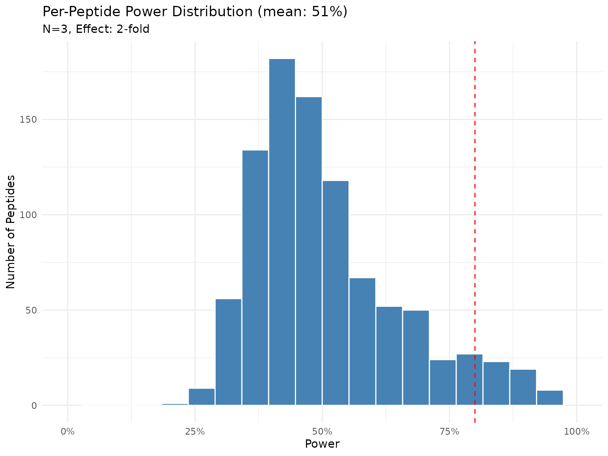{fig-align="center" width="70%"}

::: {.notes}
Across the peptidome the median per-peptide power is low, and only a small fraction of peptides clear the conventional eighty percent line. This is much smaller than most people doing these experiments would think and actually massively restricts the interpretation we can put on data like this. The discovery experiment is best read as a hypothesis-generating method — generating candidates for follow-up — rather than as a definitive list of regulated peptides.
:::

## What $n$ would reach half-peptidome 80% power?

**$n = 15$ per group.**

*Roughly five times the discovery norm of three.*

::: {.notes}
So let's ask the inverse question. Asking peppwR what sample size would put half the peptidome at or above eighty percent power, for a two-fold effect, returns fifteen per group. That is roughly five times the discovery norm of three. It doesn't mean your previous experiment was wrong but it does give a budget for the next one if you want it to be discriminatory in the way we often assume.


So these are the sort of questions that peppwR can help you answer, when you've worked out the number of reps you need for the power you expect to have, then its on to actually doing the experiment.
:::


<!--
## PRM case study with missingness

*Magnaporthe oryzae*, $285$ targeted phosphopeptides

- Three biological reps per timepoint; two tech reps averaged.
- Dataset-level MNAR diagnostic: clear negative $\rho$.
- `include_missingness = TRUE` vs `FALSE`.

::: {.notes}
A second case study uses the other major mass-spec workflow: PRM, parallel reaction monitoring, a targeted run that contrasts with DDA. The organism is *Magnaporthe oryzae*, the rice blast fungus. Two hundred and eighty-five targeted phosphopeptides, three biological replicates per timepoint, and two technical replicates averaged before analysis. When we run a dataset-level MNAR diagnostic — the same Spearman correlation as before — returns a clear negative value. Running the simulation with `include_missingness = TRUE` and then with `FALSE` shows how much of the nominal power is an artefact of pretending no values were missing.
:::
-->
---

## pepdiff {.section-divider}

{width=220 fig-align="center"}

*The same data, from the other end.*

*Differential abundance for phosphopeptides.*

::: {.notes}
And when you've done all the straightforward lab stuff and a spreadsheet of intensities has landed on your desk, you can use `pepdiff`. The same data quirks that motivated the simulation engine — skew, MNAR, multiple testing — are now the analyst's problem rather than the planner's. `pepdiff` is the package built around handling them at the inference stage.
:::

## Input data shape

| peptide | gene | treatment | timepoint | bio_rep | abundance |
|---|---|---|---|---|---|
| AAGSPQK | AT1G01010 | ctrl | T0 | 1 | 12.4 |
| AAGSPQK | AT1G01010 | trt  | T0 | 1 | 18.7 |
| LLDDVPK | AT1G01020 | ctrl | T0 | 1 | 3.1 |
| ... | ... | ... | ... | ... | ... |

::: {.notes}
`pepdiff` takes as input a long-format table - one row per peptide per sample, with columns naming the peptide, the gene it maps to, the experimental factors — treatment, timepoint, and the  measured abundance. This is the format most quantification tools already export.
:::

## The workflow at a glance

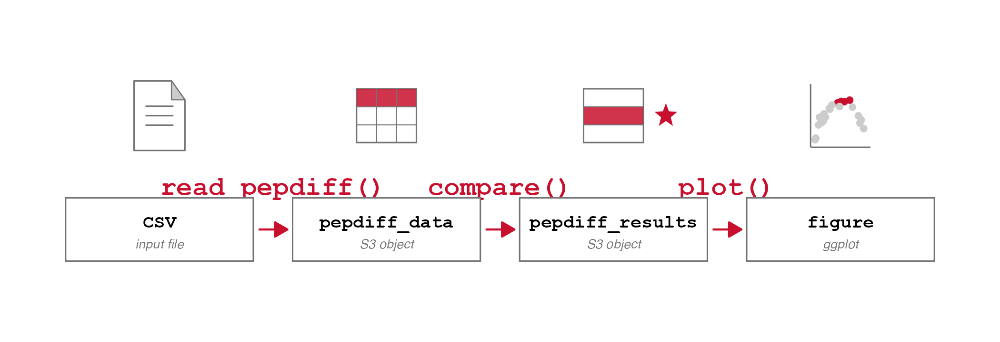{fig-align="center" width="95%"}

::: {.notes}
The whole pipeline, left to right. A CSV goes in through `read_pepdiff()`, which returns a `pepdiff_data` object. That object goes through `compare()`, which returns a `pepdiff_results` object. And `plot()` on the results gives the post-analysis diagnostics. The two object contain the results of all the analyses, with one plotting endpoint.
:::

## Reading the data

```r
dat <- read_pepdiff(
  file      = "phospho_intensities.csv",
  id        = "peptide",
  gene      = "gene_id",
  value     = "value",
  factors   = c("treatment", "timepoint"),
  replicate = "bio_rep"
)
```

*Returns a `pepdiff_data` S3 object with `print`, `summary`, `plot` methods.*

::: {.notes}
The first step, loading the data is done by `read_pepdiff()` which takes the path to the CSV plus the names of the columns that play each role. The column-name arguments are how the function knows what is what. The return value is a typed object the rest of the pipeline can dispatch on, no analysis in this yet, just a structured data container.
:::

## Exploratory triptych

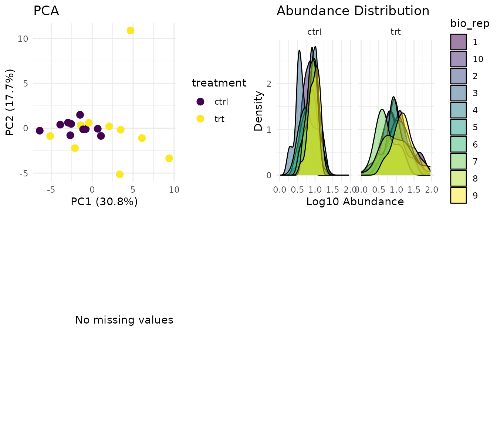{fig-align="center" width="80%"}

*`plot()` on a `pepdiff_data` object — diagnostics before any model is fitted.*

::: {.notes}
Calling `plot()` on a `pepdiff_data` object returns three exploratory views, letting you see the state of the data before any model is fitted. On the left, a PCA of samples, coloured by treatment — replicates from the same condition should cluster. In the centre, per-sample density curves of log intensity overlaid — large horizontal shifts here flag a normalisation problem. And on the right, per-peptide mean abundance against per-peptide NA rate — the same MNAR diagnostic we used at the planning stage.
:::

## Why fit a model at all?

Helps calculate how big the change is, and how likely it is given a null

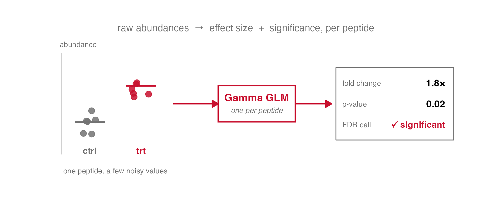{fig-align="center" width="92%"}

::: {.notes}
 Over in peppwR the reason to simulate was clear — we had no data yet, so we generated it. Here the data have already arrived: the spreadsheet of intensities is sitting in front of us. So why fit a model at all, rather than just look at the numbers?

Because ultimately we need to know how unlikely any perceived differences are going to be under a null model. So that null has to be the right one. For every peptide we have to work out an effect size, and a p-value, which then becomes an FDR once we account for all the other peptides.

The model is the machine that helps us do the maths on a handful of noisy, skewed abundances. Implementing that is the whole job of this stage of pepdiff. The next slides are just how the machine is built — and it starts from something you already know: a regression line.
:::

## Really, it's just a regression

*The **slope** is the change. The **scatter** around the line is the confidence.*

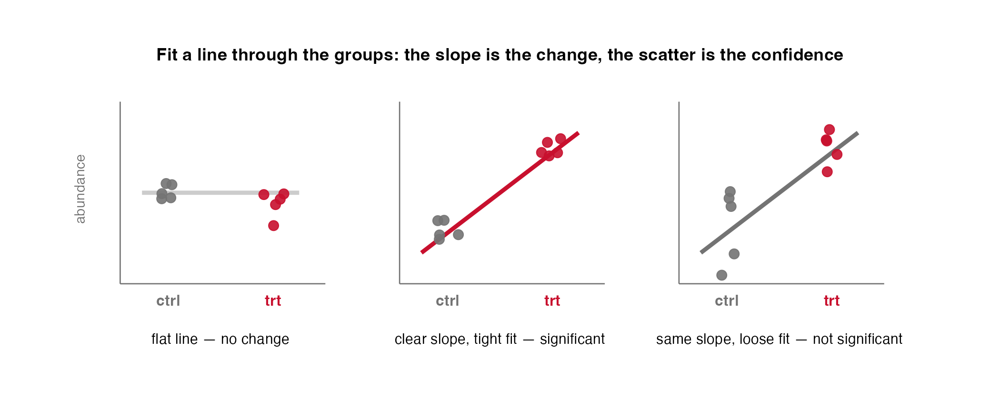{fig-align="center" width="95%"}

::: {.notes}
Here's the whole idea,  a straight line fitted through two groups. Put condition on the horizontal axis, control on the left, treatment on the right, and abundance up the side. Drop in the measurements and fit the best line through them.

 On the left panel the line is flat: the treatment points sit at the same height as the control points, the line has no slope, and we have no reason to claim any change. In the middle panel the line clearly rises: treatment is higher than control, and — this is the first half of what we want — the steepness of that slope *is* the size of the change, the effect. So slope answers "how big".

Compare the middle and right panels: the line has exactly the same slope in both. What differs is how tightly the points fit.  That spread around the line — the goodness of fit — is what drives significance. Tight fit, small p-value; loose fit, large p-value.

So the fitted regression - our model gives us both numberswe need.The important thing for the maths is that the pattern of scatter is properly described. If it isn't we get bad estimates of significance. Thats why a standard regression isn't useful and why we use a more flexible on called a GLM. Because  the cloud of points around the line is skewed from proteomics data, not the tidy symmetric scatter drawn here, so we swap the noise model for a gamma.
:::

## The per-peptide gamma GLM

$$Y_{ij} \;\sim\; \text{Gamma}(\mu_{ij}, \phi_i)$$

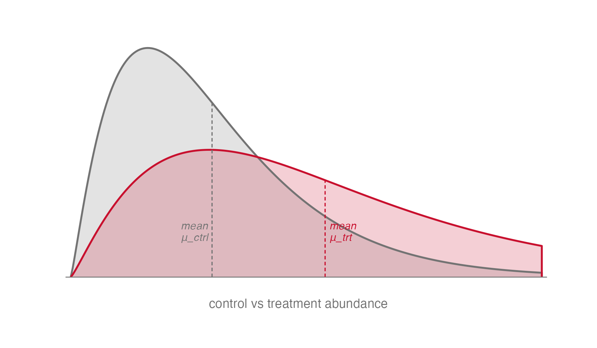{fig-align="center" width="70%"}

- The treatment moves the curve's mean abundance,
- $\mu_\text{ctrl}\!\rightarrow\!\mu_\text{trt}$.

::: {.notes}

Typically we'd use a gamma distribution based model, because it matches the abundance data pretty well, it is strictly positive, and right-skewed — the same family we used at the planning stage in peppwR.

So read the equation as: the measured abundance Y for peptide i in sample j is a draw from a gamma distribution whose mean is mu, and each peptide carries its own spread parameter phi-sub-i, so we are not forcing every peptide to share one variance.

The picture is one peptide and two gamma curves, a control in grey and treatment in red, each with its own mean and variance.

So with these two idealised gamma curves we can do the same analysis as we did when we were looking at power, selecting alpha and finding p.
:::

## What a gamma GLM gives us

- **A $p$-value we can trust** — it describes each peptide's own *skewed* scatter, so the null is the right one.
- **The effect as a fold change** — treatment vs control, the number you'd actually report.

::: {.notes}
So that is the whole model step, and it gives back the two numbers we said we needed, for every peptide.

The first is a p-value we can actually trust because we selected a model that matches the right-skew of real abundances.ne.

The second is the size of the change, and it comes out as a fold change because of the exponential nature of the gamma distribution. — treatment over control, twice as much, half as much. That is the language we already use for results, and we don't have to do anything to get it; it falls straight out of the model.
:::

## Contrasts via `emmeans`

- Treatment minus control at a fixed timepoint.
- Treatment $\times$ timepoint interaction.
- Marginal effect of treatment averaged over timepoints.

*Extracted via the `emmeans` package — R's standard tool for estimated marginal means and contrasts.*

::: {.notes}
The contrasts we usually want — treatment minus control at a particular timepoint, the interaction between treatment and timepoint, the  effect of treatment averaged over timepoints — are extracted from the fitted model via `emmeans`, the standard R package for estimated marginal means. Each contrast yields, per peptide, an effect size and a $p$-value. This enables you to make experimental designs with as many variables as you like and not just strict treatment control comparisons.
:::

## Running the comparison

```r
results <- compare(
  dat,
  compare = "treatment",
  ref     = "ctrl",
  method  = "glm"
)
```

*Returns a `pepdiff_results` object.*

::: {.notes}
This is the code for that, just put the variables you want to use in the function call. One call, one returned object. The `results` table holds, per peptide and per contrast, the fold change, the log-two fold change, the raw $p$-value, the BH-adjusted FDR, and a Boolean `significant` flag at the conventional FDR-of-0.05 threshold. The FDR is calculated in the same way as before and applied to each comparison group by default.
:::

<!--
## Multiple testing, again

$$p_{(k^*)} \;\leq\; \frac{k^* \alpha}{m}$$

*Stored in the `fdr` column. Applied within each comparison group via `apply_fdr_by_comparison()` when designs are nested.*

::: {.notes}
The same fix we used at the planning stage. With $m$ peptides tested simultaneously, raw $p$-values are not interpretable in isolation, so pepdiff applies Benjamini–Hochberg and stores the result in the `fdr` column. When the design is nested — when one `compare()` call produces contrasts within several timepoints — the correction is applied within each comparison group by default, so that a peptide does not have its significance budget consumed by tests from a different stratum. Pooling all comparisons before correcting is more conservative and is a perfectly defensible alternative. Prose lines 405–415.
:::
-->


## Check the GLM fits

`plot_fit_diagnostics()`

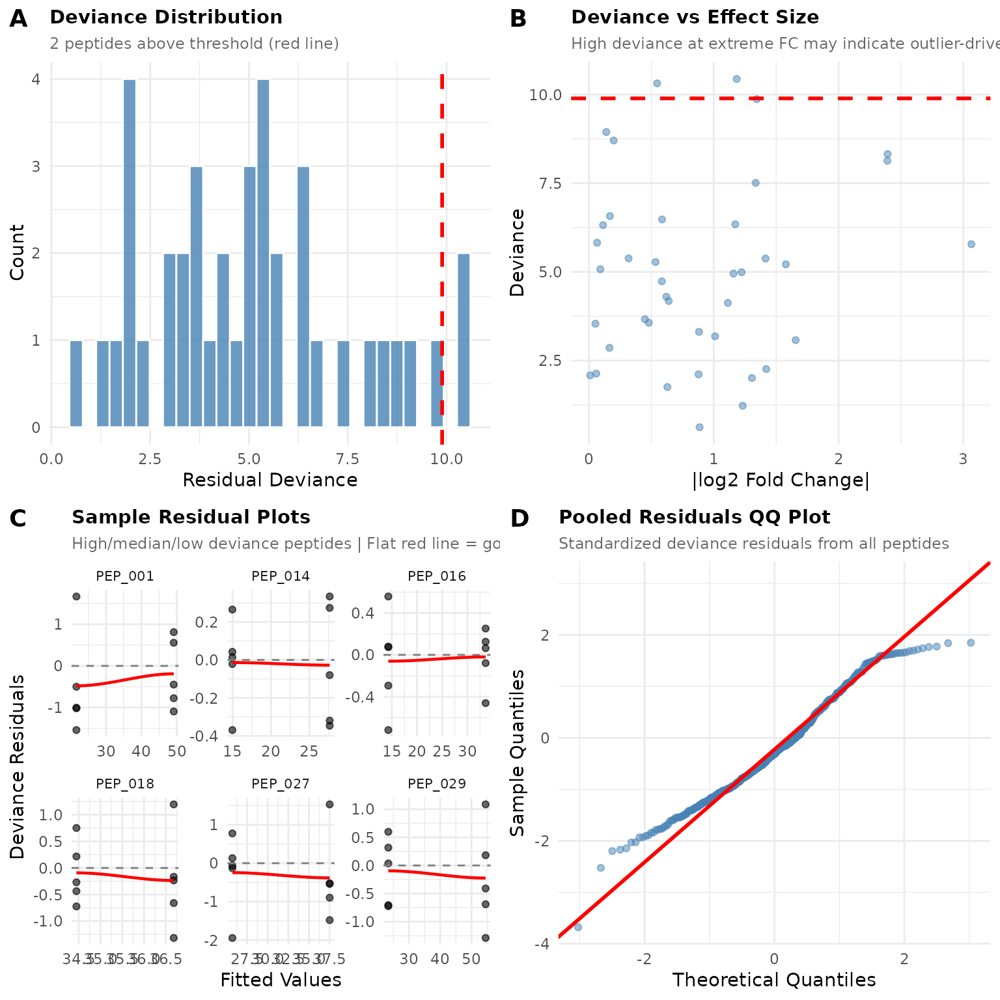{fig-align="center" width="75%"}

::: {.notes}
A per-peptide gamma GLM is not universally appropriate. For some peptides the family is wrong. . `plot_fit_diagnostics()` returns a four-panel summary so we can check this directly. Top-left: the distribution of per-peptide deviances, with a 95th-percentile threshold marked. Top-right: deviance plotted against log-two fold change, with poorly fitted peptides highlighted. Bottom-left: standardised residuals against fitted values for three example peptides — a high-, median-, and low-deviance one. Bottom-right: a pooled QQ plot of standardised residuals across the whole peptidome. Heavy tails or systematic S-shapes in that QQ plot are the signal that the family is not a great fit.
:::

## When to switch

- Below ~10–15% high-deviance peptides + roughly linear QQ $\rightarrow$ keep the gamma GLM.
- Above ~15% high-deviance, or systematic curvature $\rightarrow$ switch to ART.

::: {.notes}
If the proportion of peptides flagged as high-deviance is below roughly ten to fifteen percent and the QQ plot is roughly linear, the gamma GLM result should be ok. If more than around fifteen percent of peptides are flagged, or the residual plots show systematic curvature, the recommended response is to switch to the Aligned Rank Transform procedure
:::

## Aligned Rank Transform (ART)

1. **Align** — remove what the other factors contribute, leaving values that move only with the effect you're testing.
2. **Rank** — replace those aligned values by their ranks.
3. **ANOVA on ranks** — run an ordinary factorial ANOVA on the ranks.

*Handles interactions, which classical rank-based tests cannot. Returns rank-based statistics, not fold changes.*

::: {.notes}
ART is a nonparametric procedure for factorial designs. The recipe has three steps. Say we have treatment and timepoint, and we want to test treatment. We take out of each value what the other factors — here, timepoint — contribute, so the numbers are affected just by treatment. Then we replace those aligned values with their ranks. And then we run an ordinary factorial ANOVA on those ranks. The alignment step is what makes interactions tractable,and the ranking step is what frees us from having to pick a parametric family. The price paid is in interpretation. ART returns rank-based statistics rather than fold changes, so for effect-size reporting we keep the GLM fit alongside the ART significance call.
:::

## Running ART

```r
results_art <- compare(
  dat,
  compare = "treatment",
  ref     = "ctrl",
  method  = "art"
)
```


::: {.notes}
We can use it with a nearly identical call as we had for the GLM, and get identical output shape. The switch is the method argument. The downstream plots and the `fdr` column behave the same way as before.
:::

## Pairwise tests for simpler designs

`method = "pairwise"`

- **Wilcoxon** — documented default for small-$n$, non-normal, outlier-prone data.
- **Bootstrap-$t$** — four or more replicates, roughly symmetric data.
- **Bayes-factor $t$-test** — evidence strength; useful when "no detectable effect" is the finding.
- **Rank-products** — sensitive to small effects whose direction is consistent across replicates.

::: {.notes}
For the simplest designs — two groups, no factorial structure, small $n$ — neither a GLM nor ART is strictly necessary. `method = "pairwise"` runs a single per-peptide two-sample test, with the `test` argument choosing between four options. Wilcoxon is the documented default for the small-$n$, non-normal, outlier-prone regime that phosphoproteomics typically sits in. Bootstrap-$t$ is appropriate for four or more replicates with roughly symmetric data. The Bayes-factor $t$-test is useful when the question is about evidence strength — particularly when "no detectable effect" is the finding one wants to express. And rank-products is sensitive to small consistent effects whose direction agrees across replicates. The first three are the same tests peppwR's simulation engine supports at the planning stage.
:::

## Match the test at both stages

| Planning (peppwR) | Analysis (pepdiff) |
|---|---|
| `wilcoxon` | `wilcoxon` |
| `bootstrap_t` | `bootstrap_t` |
| `bayes_t` | `bayes_t` |
| | `rank_products` |

*Power for the test you will actually run.*

::: {.notes}
If we pick the same test at the planning stage and at the analysis stage, the power calculation is estimating power for the test that will actually be run, rather than for a convenient proxy. A design powered for a $t$-test and then analysed with a Wilcoxon is asking and answering different questions. Matching the test at both ends keeps the calculation clear.
:::

## Reading the output

`plot(pepdiff_results)`

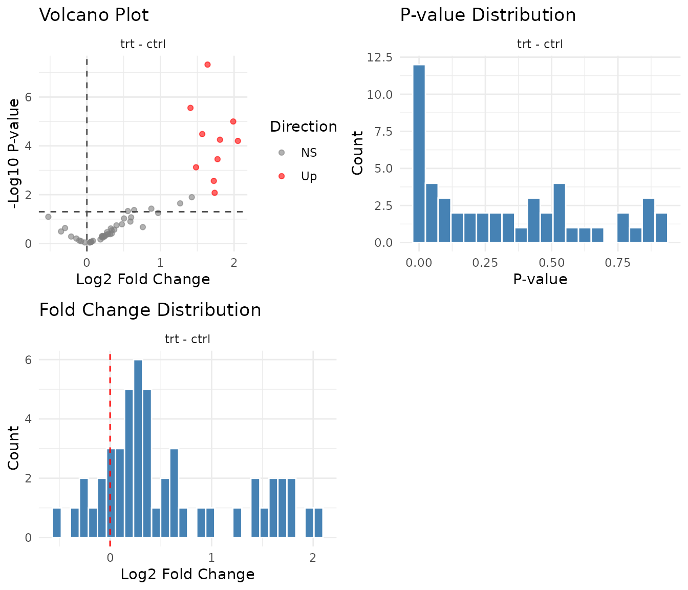{fig-align="center" width="80%"}

::: {.notes}
Calling `plot()` on a `pepdiff_results` object returns three views, side by side. On the left, a typical volcano plot — minus log-ten of the FDR against log-two fold change, with the FDR-0.05 line and a fold-change threshold marked, and significant peptides coloured. In the centre, a histogram of raw $p$-values. On the right, a density of log-two fold changes across all peptides. The volcano is the customary endpoint, the one most people look at first; the other two are diagnostics for whether the volcano is to be trusted.
:::

## The $p$-value histogram is diagnostic of tests

- **Flat base + spike near zero** — well-calibrated test, mix of nulls and alternatives.
- **U-shape** — something upstream of FDR is mis-specified.
- **Spike at one or non-flat baseline** — wrong family, unmodelled batch effect, normalisation problem.

::: {.notes}
The $p$-value histogram is a massively under-used diagnostic that does work to tell us whether our tests were useful for our data. A flat baseline with a spike near zero is the expected signature of a well-calibrated test under a mix of nulls and alternatives — the spike is the real effects, the flat part is the nulls. A U-shape, a spike at one, or a non-flat baseline is a signal that something upstream of the FDR step has gone wrong — a wrong family, an unmodelled batch effect, a normalisation problem — and that the FDR column deserves a sceptical reading until the cause is found.
:::

## Filtered output

```r
significant(results)
```

*Returns the filtered peptide list, ready to join onto gene annotations or pipe into enrichment.*

::: {.notes}
The last step in `pepdiff` is the `significant()` function on a results object returns the filtered peptide list, ready to be joined back onto gene annotations or piped into downstream enrichment.
:::

---

## Takeaways

- **Most experiments are underpowered** — and an underpowered run quietly misses real effects, whole swathes of them at scale.
- **Decide sample size before you start** — power belongs to the design, and the $n=3$ habit is usually far too small.
- **Real data breaks the textbook $t$-test** — skew, missing values and thousands of tests need simulation, not a closed-form formula.
- **Match planning to analysis** — plan power with peppwR, call differences with pepdiff, using the same test at both ends.

::: {.notes}
Four things to leave with. First, most experiments are underpowered, and underpowered does not mean "a bit weaker" — it means quietly missing real effects, and at high-throughput scale that is whole swathes of real biology going uncalled. Second, the fix is upstream: power belongs to the design, so decide the sample size before you start, because the habitual three-per-group is usually far short of what you need. Third, real data — skewed, full of missing values, thousands of tests at once — breaks the textbook t-test, so we estimate power by simulation rather than a closed-form formula. And fourth, plan and analysis are two halves of one workflow: power with peppwR before, differential abundance with pepdiff after, tied together by using the same test at both ends.
:::
<!--
## One sentence each

- **peppwR** — *for the experiment you are about to run.*
- **pepdiff** — *for the one you have already finished.*

::: {.notes}
peppwR for the experiment you are about to run; pepdiff for the one you have already finished.
:::
-->

## Questions?

**peppwR**

`https://cran.r-project.org/package=peppwR`
`https://teammaclean.github.io/peppwR/`

**pepdiff**

`https://cran.r-project.org/package=pepdiff`
`https://teammaclean.github.io/pepdiff/`

::: {.notes}
Both packages are on CRAN, so a plain install.packages will get you started, and the documentation sites have the worked examples. Happy to take questions.
:::
